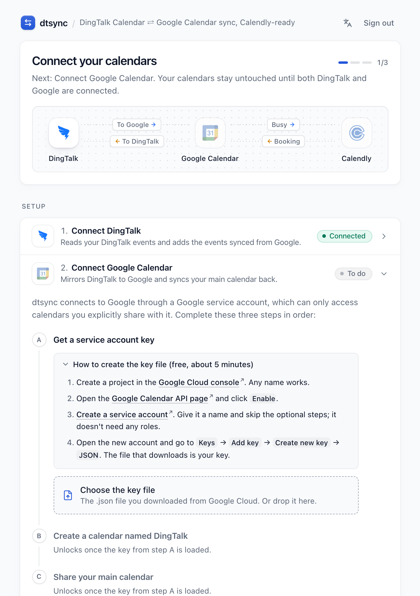

# dtsync — DingTalk Calendar ⇄ Google Calendar (Calendly-ready)

**English** | [简体中文](README.zh-CN.md)

dtsync keeps DingTalk Calendar and Google Calendar in sync, in both directions. It works with
Calendly out of the box, and with other booking tools that write to Google Calendar, such as
Cal.com.

DingTalk Calendar only offers CalDAV, so it can't connect to Google Calendar or Calendly
directly. dtsync sits between DingTalk and Google and syncs them automatically:

1. **DingTalk → Google.** Every event in your DingTalk calendar, including recurring meetings,
   is copied to a dedicated *DingTalk* calendar in Google. You can see your work schedule in
   Google Calendar, and Calendly can avoid the times you're busy.
2. **Google → DingTalk.** Events in your Google main calendar are copied to DingTalk within a
   minute or two: new events, reschedules, and cancellations. By default only Calendly bookings
   are copied; you can switch to all events or to events matching a pattern.

```
DingTalk ───events────▶ [ dtsync ] ──▶ Google "DingTalk" calendar  (──▶ optional: Calendly checks it)
DingTalk ◀───events──── [ dtsync ] ◀── Google main calendar        (◀── optional: Calendly bookings)
```



## What you need

- A DingTalk account.
- A Google account. It doesn't have to be the account you use day to day.
- Somewhere to run dtsync: a free Cloudflare account (recommended), or any server or computer
  with Docker or Node.js 20+.
- Optional: a Calendly account connected to that Google account, only if you want a public
  booking link. The free plan works.

> Setup and syncing both need access to Google and Cloudflare. If `workers.dev` addresses are
> blocked on your network, add a custom domain to the Worker in Cloudflare.

## Quick start on Cloudflare

About 15 minutes, no terminal needed.

1. Click the button and sign in to Cloudflare. When prompted for `ADMIN_PASSWORD`, choose a
   password of at least 8 characters.

   [](https://deploy.workers.cloudflare.com/?url=https://github.com/Alpiiine/dingtalk-calendar-sync)

2. Open the address of your new Worker (it ends in `workers.dev`) and sign in with that password.
3. Follow the three steps on the page. Saving steps 1 and 2 tests the connection first, and if
   something is wrong, the page tells you what to fix.
   1. **DingTalk**: paste the CalDAV username and password from DingTalk → Calendar →
      Calendar settings → CalDAV sync.
   2. **Google Calendar**: upload a Google service account key (the page walks you through
      creating one, free, in about 5 minutes), create a calendar named *DingTalk*, and share
      both your main calendar and the new *DingTalk* calendar with the service account email.
   3. **Calendly (optional)**: only if you share booking links. Under Settings → Scheduling →
      Calendars, select both calendars in *Calendars to check for conflicts*, then click
      **Complete setup**.

      Not using Calendly? Click **Skip this step**. To copy everyday events from your Google
      main calendar to DingTalk, open **Options** and change *Events to copy from your main
      calendar* from *Calendly bookings only* to *All events* or *Events matching a pattern*.
      The default stays at *Calendly bookings only* so that a first setup never copies a
      private Google calendar into a company DingTalk.

From then on, dtsync runs automatically every minute; no app or browser tab needs to stay open.
The page shows when it last ran and what changed. **Sync now** runs a sync immediately, and
**Preview changes** shows what a sync would do without touching any calendar. On Cloudflare,
the first scheduled run can take up to 15 minutes to start.

The first sync copies your existing events in batches, one batch per minute, and the status
reads **Catching up** until it's done. Until it reads **Live**, Google Calendar and Calendly
can't see all of your DingTalk events, so wait before sharing a booking link.

## Other ways to run it

Each of these runs from a clone of the repository:

```sh
git clone https://github.com/Alpiiine/dingtalk-calendar-sync && cd dingtalk-calendar-sync
```

**Cloudflare, from a terminal**

```sh
./setup.sh        # signs in, deploys, sets the admin password, and prints the address
```

**Docker** (Compose builds the image from the clone; nothing is pulled from a registry)

```sh
docker compose up -d
docker compose logs dtsync    # shows the admin password generated on first start
```

Then open <http://localhost:8787>. Settings and sync state are stored in the `dtsync-state` volume.

**Node.js 20+** (no dependencies to install)

```sh
node cli.js serve     # setup page on http://localhost:8787, syncs every minute
node cli.js doctor    # test the saved credentials and calendar access
node cli.js once      # run one sync; add --dry-run to only print what would change
node cli.js watch     # sync every minute without the setup page
```

Apart from `ADMIN_PASSWORD` and the optional `PORT` and `INTERVAL_SECONDS`, dtsync reads nothing
from environment variables or Worker secrets. Credentials, calendars, and options are entered
only on the setup page. Docker and Node generate an admin password on first start. To
choose your own, or to change the port (`PORT`) or the interval between syncs
(`INTERVAL_SECONDS`), copy `env.example` to `.env`. The password must be at least 8 characters,
or the setup page stays locked.

Run only one instance against the same calendars. Multiple instances keep separate sync state
and conflict with each other.

### Updating

Saved credentials, options, and sync state are stored separately from the code (in Workers KV,
the `dtsync-state` volume, or `state.json`), so updating keeps them. Check
[CHANGELOG.md](CHANGELOG.md) for upgrade notes first.

- **Deploy button:** the button created a copy of this repository in your GitHub account and
  connected it to your Worker. The copy is not a GitHub fork, so it has no **Sync fork** button.
  Merge this repository's latest changes into it and push, and Cloudflare redeploys.
- **`setup.sh`:** run `git pull`, then `./setup.sh` again. Leave the password empty to keep the
  current one.
- **Docker:** `git pull && docker compose up -d --build`
- **Node.js:** run `git pull`, then restart `node cli.js serve`.

## Options

Change these under **Options** on the setup page.

| Option | Default | What it does |
|---|---|---|
| Synced event language | English | English or 简体中文 for the text dtsync writes into events, such as "Busy (DingTalk)". Independent of the page's display language. |
| Hide DingTalk event titles in Google | Off | When enabled, Google and Calendly only see "Busy (DingTalk)" instead of actual meeting titles. |
| Events to copy from your main calendar | Calendly bookings only | Which events from your Google main calendar are copied to DingTalk. Choose *Calendly bookings only*, *All events*, or *Events matching a pattern* (checked against the title, description, location, and creator or organizer email, case-insensitive). For another booking tool such as Cal.com, use a pattern that matches its events, for example `cal\.com`. |
| Title prefix in DingTalk | Empty | Optional, e.g. `Calendly: `. |
| Days ahead to sync | 90 | If you use Calendly, set this at least as far ahead as its booking window ("invitees can schedule … days into the future"). |
| Advanced: Recurring event lookback (days) | 730 | DingTalk reports a recurring event only by its first date, so dtsync looks back this far to find series that are still running. Increase it if a recurring meeting that started over two years ago is missing from Google. |
| Advanced: Full DingTalk refresh interval (minutes) | 15 | A safety net. dtsync reads DingTalk in full at this interval, even when DingTalk reports no changes. Lower it if DingTalk changes reach Google late. On Cloudflare's free plan, keep it at 5 or higher. |
| Advanced: Max calendar writes per run | 30 on Cloudflare Workers, no limit elsewhere | The maximum number of events created, updated, or deleted per run. Anything left over continues on the next run. The default of 30 stays within the free plan's limit of 50 outbound requests per run. Raise it on a paid Workers plan to finish large syncs faster. 0 means no limit. |
| Advanced: Fallback time zone | Your browser's time zone | Used when a DingTalk event has no time zone. This is rare, because DingTalk sets one on every timed event. Defaults to the time zone of the browser that first opened the setup page. Change it if events show up in Google a few hours off. |
| Debug mode | Off | See [Privacy](#privacy). Automatically turns off after 24 hours. |

## Privacy

dtsync runs in **your own** Cloudflare account or on your own machine. It talks directly to
DingTalk and Google, and sends your data nowhere else.

- **Stored:** the credentials you entered (encrypted with a key derived from your admin password)
  and sync history, meaning event IDs, hashes, and times.
- **Not stored:** the titles, descriptions, locations, or attendees of any event.
- **Logs:** event titles and attendee details are excluded. **Debug mode** adds event titles and
  every network request to the server log and to the results of **Sync now** and **Preview
  changes** on the page, to help track down a problem. It turns itself off after 24 hours.
- **Disconnect:** *Options → Disconnect and delete saved data* permanently deletes saved
  credentials and sync history from the server. Existing events in your calendars are never
  modified or deleted. To remove the synced DingTalk events, delete the *DingTalk* calendar in Google.

For details and how to report a vulnerability, see [SECURITY.md](SECURITY.md).

## Good to know

- A DingTalk event reaches the Google *DingTalk* calendar within one to two minutes, and the
  slot then becomes unavailable in Calendly.
- Each calendar syncs one way. DingTalk events go to the Google *DingTalk* calendar, and events
  from your Google main calendar (Calendly bookings by default) go to DingTalk. Nothing travels
  back: editing or deleting a synced event in DingTalk changes nothing in Google and doesn't
  cancel a Calendly booking, and dtsync won't add a deleted one again. Edits made in the Google
  *DingTalk* calendar are overwritten, so change those events in DingTalk.
- DingTalk drops the location field of events created by other apps, so dtsync adds the
  location, meeting link, and attendee list to the description.
- If more than half of the synced DingTalk events would disappear from Google at once, dtsync
  waits for the next run to confirm before removing them, so a glitch on DingTalk's side can't
  open up your whole calendar.
- dtsync supports daily, weekly, monthly, and yearly recurrences with intervals, end dates,
  counts, rules like "second Tuesday" or "last Friday", and skipped or moved occurrences. That
  covers everything DingTalk's own editor can produce.
- Cloudflare's free plan allows 10 ms of CPU time per run. That's enough for typical calendars;
  a very large one may need the paid plan.

## Troubleshooting

Rows that start with **Error** quote a message the setup page shows. The rest describe what
you might notice.

| Problem or error | Cause and fix |
|---|---|
| Error: "Invalid DingTalk CalDAV username or password" | DingTalk's CalDAV server didn't accept the credentials. Step 1 takes the dedicated username and password generated under DingTalk → Calendar → Calendar settings → CalDAV sync, **not your DingTalk login password**. Generate a new pair there and paste both the username and the password again. |
| Error: "The Google service account cannot access calendar …" | That Google calendar isn't shared yet with the Google service account email from step 2 (it looks like `xxx@….iam.gserviceaccount.com`), or the calendar ID is wrong. In Google Calendar, open the calendar's settings, add that email under **Share with specific people or groups**, and compare the ID with the one under **Integrate calendar**. |
| Error: "The Google service account does not have permission to modify events in …" | The *DingTalk* calendar is shared with the service account, but only with **See only free/busy** or **See all event details**. In the calendar's sharing settings in Google Calendar, change the service account's permission to **Make changes to events**. |
| Error: "Cannot decrypt saved credentials (ADMIN_PASSWORD may have changed)" | Saved credentials are encrypted with `ADMIN_PASSWORD`. After the admin password changes, what was saved under the old one can't be decrypted. Enter and save steps 1 and 2 again. |
| Google won't create a key | Some organizations block service account keys. Use a personal Google account for the Cloud project; the calendars can still belong to any account. |
| Events in my Google main calendar don't reach DingTalk | By default only Calendly bookings are copied. Under **Options**, change *Events to copy from your main calendar* to *All events* or *Events matching a pattern*. |
| The DingTalk calendar is missing from Calendly | Disconnect and reconnect Google Calendar in Calendly to refresh your calendars. |
| Nothing happens after deploying | The first scheduled run on Cloudflare can take up to 15 minutes. Click **Sync now** to start right away. |
| DingTalk or Google can't be reached during setup | Under the step, open *Can't reach DingTalk right now?* or *Can't reach Google right now, or want to finish later?*, then choose **Save without testing**. Syncing fails until the values are right, so test them once you can. |

Still stuck? Turn on **Debug mode**, click **Sync now**, and open an issue with the output
(remove anything private first).

## How it works

Two calendars, each synced in one direction. Each run reads DingTalk only when something
changed and makes the Google *DingTalk* calendar match it. It then syncs the selected events
from your Google main calendar (Calendly bookings by default) to DingTalk, leaving everything
else in your DingTalk calendar untouched. Nothing is written back to either source, so a
change made to a synced copy never alters the original.
DingTalk's CalDAV server silently ignores edits, among other quirks, so a changed event is
deleted and re-created. The measurements behind this design are in
[docs/dingtalk-caldav.md](docs/dingtalk-caldav.md).

dtsync is under 2,000 lines of JavaScript, excluding locale files. It has no dependencies, uses
only `fetch` and WebCrypto, and runs unchanged on Node 20+, Docker, and Cloudflare Workers. The
setup page is a small React app in [`web/`](web) built with
[Animate UI](https://github.com/imskyleen/animate-ui). It's compiled into a single inline HTML
document (`src/ui.gen.js`, checked into the repository), so you don't need to install anything
to run or deploy dtsync.

## Development

```sh
npm test        # the full suite, against in-memory DingTalk and Google
npm run demo    # the real setup page against those stand-ins; no accounts needed

npm run ui:install && npm run ui:build   # only after changing the setup page in web/
```

See [CONTRIBUTING.md](CONTRIBUTING.md). Issues and pull requests are welcome.

## License

[MIT](LICENSE)

DingTalk, Google Calendar, and Calendly are trademarks of their respective owners. Their logos
appear on the setup page only to identify those services; this project is not affiliated with or
endorsed by any of them.
