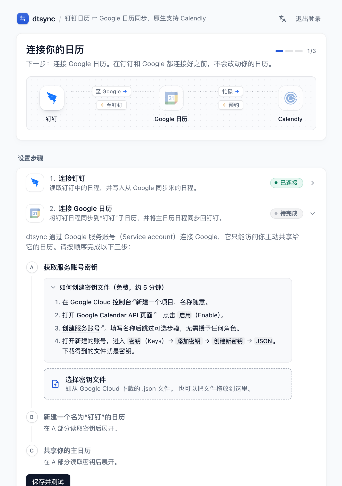

# dtsync — 钉钉日历 ⇄ Google 日历同步（原生支持 Calendly）

[English](README.md) | **简体中文**

dtsync 是钉钉日历与 Google 日历之间的双向同步工具，原生支持 Calendly，也适用于 Cal.com 等把预约写入 Google 日历的预约工具。

钉钉日历只提供 CalDAV 接口，无法直接连通 Google 日历或 Calendly。dtsync 架在钉钉日历与 Google 日历之间，自动完成两个方向的同步：

1. **钉钉 → Google**：把钉钉中的所有日程（含重复会议）同步到一个专门的 Google“钉钉”子日历。你可以在 Google 日历中查看工作安排，Calendly 也能据此自动避开忙碌时段。
2. **Google → 钉钉**：把 Google 主日历中的日程在 1–2 分钟内同步回钉钉，包括新建、改期和取消。默认只同步 Calendly 预约，也可以改为全部日程，或只同步匹配指定规则的日程。

```
钉钉日历 ────日程─────▶ [ dtsync ] ──▶ Google "钉钉" 日历  (──▶ 可选：Calendly 据此检查冲突)
钉钉日历 ◀──日程/预约── [ dtsync ] ◀── Google 主日历       (◀── 可选：Calendly 将预约写入这里)
```



## 需要准备

- 一个钉钉账号。
- 一个 Google 账号，不必是你日常使用的主力账号。
- 运行 dtsync 的环境：免费的 Cloudflare 账号（推荐），或装有 Docker 或 Node.js 20+ 的服务器或本地电脑。
- 可选：一个已连接该 Google 账号的 Calendly 账号，仅在需要对外预约链接时使用，免费版即可。

> 提示：设置和运行都需要访问 Google 与 Cloudflare。如果所在网络无法打开 `workers.dev` 域名，可以在 Cloudflare 中为 Worker 绑定自己的域名。

## 在 Cloudflare 上快速开始

大约 15 分钟，无需使用终端。

1. 点击下面的按钮并登录 Cloudflare。提示填写 `ADMIN_PASSWORD` 时，设置一个至少 8 个字符的密码。

   [](https://deploy.workers.cloudflare.com/?url=https://github.com/Alpiiine/dingtalk-calendar-sync)

2. 打开新建 Worker 的地址（以 `workers.dev` 结尾），用刚才的密码登录。
3. 按页面上的三个步骤操作。保存第 1、2 步时会先测试连接，若有问题页面会直接给出修改提示。
   1. **钉钉**：在钉钉 → 日历 → 日历设置 → CalDAV 同步中获取 CalDAV 用户名和密码，粘贴到页面上。
   2. **Google 日历**：上传 Google 服务账号的密钥（页面会一步步引导你免费创建，约 5 分钟），新建一个名为“钉钉”（或 DingTalk）的日历，再把主日历和这个新日历都共享给服务账号邮箱。
   3. **Calendly（可选）**：仅在需要对外预约链接时设置。在 Settings → Scheduling → Calendars 的 *Calendars to check for conflicts* 中勾选这两个日历，然后点击**完成设置**。

      不使用 Calendly？点击**跳过这一步**即可。如果只希望把 Google 主日历的日常安排同步到钉钉，请在**选项**中把“将哪些主日历日程同步至钉钉”从默认的“仅 Calendly 预约”改为“全部日程”或“匹配指定规则的日程”。默认值之所以是“仅 Calendly 预约”，是为了避免首次接入时把私人 Google 日历的全部日程写入公司钉钉。

完成后，dtsync 每分钟自动同步一次，无需保持页面打开。页面会显示上次同步的时间和变更内容。点击**立即同步**可马上执行一次同步；点击**预览变更**则只列出将要做的修改，不会改动任何日历。在 Cloudflare 上，新建的定时任务最多可能需要 15 分钟才开始运行。

首次同步会分批复制日历中已有的日程，每分钟处理一批，期间状态显示为**同步追赶中**。状态变为**运行中**之前，Google 日历和 Calendly 还看不到你在钉钉中的全部日程，请稍后再发出预约链接。

## 其他运行方式

先克隆仓库并进入目录，以下几种方式都在该目录中运行：

```sh
git clone https://github.com/Alpiiine/dingtalk-calendar-sync && cd dingtalk-calendar-sync
```

**Cloudflare（通过终端）**

```sh
./setup.sh        # 登录、部署、设置管理密码，并显示页面地址
```

**Docker**（Compose 在本地用仓库代码构建镜像，不从镜像仓库拉取）

```sh
docker compose up -d
docker compose logs dtsync    # 查看首次启动时生成的管理密码
```

然后打开 <http://localhost:8787>。设置和同步状态保存在 `dtsync-state` 卷中。

**Node.js 20+**（无需安装任何依赖）

```sh
node cli.js serve     # 设置页面 http://localhost:8787，每分钟同步一次
node cli.js doctor    # 检查已保存的登录凭证和日历权限
node cli.js once      # 同步一次；加上 --dry-run 则只显示将要执行的操作
node cli.js watch     # 每分钟同步一次，不启动设置页面
```

除 `ADMIN_PASSWORD` 和可选的 `PORT`、`INTERVAL_SECONDS` 外，dtsync 不从环境变量或 Worker Secrets 读取任何配置。登录凭证、日历和选项都只在设置页面中填写。Docker 和 Node 会在首次启动时自动生成管理密码。如需自行指定密码，或修改端口（`PORT`）和同步间隔（`INTERVAL_SECONDS`），请把 `env.example` 复制为 `.env` 再修改。密码至少需要 8 个字符，否则设置页面会一直处于锁定状态。

同一组日历只能运行一个 dtsync 实例。多个实例会各自维护同步状态，相互冲突。

### 如何升级

已保存的登录凭证、选项和同步状态与代码独立存储（位于 Workers KV、`dtsync-state` 卷或 `state.json`），升级不会丢失。升级前请先查看 [CHANGELOG.md](CHANGELOG.md) 中的升级说明。

- **部署按钮：** 点击按钮时，Cloudflare 会在你的 GitHub 账号下新建一个仓库，复制本仓库的代码，并与 Worker 关联。这个仓库并非 GitHub Fork，页面上没有 **Sync fork** 按钮。请把本仓库的最新改动合并进去并推送，Cloudflare 会自动重新部署。
- **`setup.sh`：** 先运行 `git pull`，再重新运行 `./setup.sh`。密码留空即可保留现有密码。
- **Docker：** `git pull && docker compose up -d --build`
- **Node.js：** 运行 `git pull`，然后重启 `node cli.js serve`。

## 选项

可在设置页面的**选项**中修改。

| 选项 | 默认值 | 含义 |
|---|---|---|
| 写入日历的日程语言 | English | dtsync 写入日程的文字使用 English 或 简体中文（如“忙碌（钉钉）”），与设置页面的显示语言无关。 |
| 在 Google 中隐藏钉钉日程标题 | 关闭 | 开启后，Google 和 Calendly 仅显示“忙碌（钉钉）”，不暴露具体会议名称。 |
| 将哪些主日历日程同步至钉钉 | 仅 Calendly 预约 | 决定 Google 主日历中的哪些日程同步到钉钉。可选“仅 Calendly 预约”“全部日程”或“匹配指定规则的日程”（匹配标题、描述、地点及创建者或组织者邮箱，不区分大小写）。使用 Cal.com 等其他预约工具时，可填写能匹配其日程的规则，例如 `cal\.com`。 |
| 钉钉日程标题前缀 | 空 | 可选，例如 `Calendly：`。 |
| 同步未来的天数 | 90 | 使用 Calendly 时，建议不小于其开放预约的最大天数。 |
| 高级：回溯过去重复日程的天数 | 730 | 钉钉只按首次发生的日期返回重复日程，所以 dtsync 会往前回溯这么多天，找出仍在进行的系列会议。如果某个两年多前开始的例会没有出现在 Google 中，请调大此值。 |
| 高级：全量扫描钉钉的间隔（分钟） | 15 | 兜底措施。即使钉钉报告没有变动，dtsync 也会按此间隔完整读取一次钉钉日历。如果钉钉中的修改迟迟没有同步到 Google，可以调小；使用 Cloudflare 免费版时请不低于 5。 |
| 高级：单次运行的日历写入上限 | Cloudflare Workers 上为 30，其他环境不限 | 单次运行最多新增、修改或删除的日程数，未完成的部分在下一次运行时继续。Cloudflare 免费版每次运行最多发出 50 个外部请求，默认值 30 不会超出这一限制；使用 Workers 付费版时可以调高，加快大批量同步。0 表示不限。 |
| 高级：无时区日程的默认时区 | 浏览器所在的时区 | 仅在钉钉日程没有时区时使用。这种情况很少见，因为钉钉的非全天日程都带有时区。默认取首次打开设置页面的浏览器所在时区。如果日程同步到 Google 后差了几个小时，请修改此项。 |
| 调试模式 | 关闭 | 见[隐私](#隐私)一节，24 小时后自动关闭。 |

## 隐私

dtsync 运行在**你自己的** Cloudflare 账号或机器上，只与钉钉和 Google 直接通信，不会把数据发送给其他第三方。

- **会保存：** 你填写的登录凭证（用管理密码派生的密钥加密），以及日程 ID、哈希值和时间等同步状态。
- **不保存：** 任何日程的标题、描述、地点和参与人。
- **日志：** 不记录日程标题和参与人信息。开启**调试模式**后，服务器日志以及页面上**立即同步**、**预览变更**的结果中会记录日程标题和每次网络请求，便于排查问题。调试模式 24 小时后自动关闭。
- **断开连接：** *选项 → 断开连接并删除已保存的数据*会从服务器彻底删除登录凭证和同步状态，但不会修改或删除日历中已有的日程。如需清除已同步的钉钉日程，在 Google 中删除“钉钉”日历即可。

更多细节以及安全漏洞的报告方式，请见 [SECURITY.md](SECURITY.md)。

## 使用须知

- 钉钉中的日程会在 1–2 分钟内同步到 Google 的“钉钉”日历，Calendly 中对应的时段随即不可预约。
- 两个日历各自单向同步：钉钉的日程同步到 Google 的“钉钉”子日历，Google 主日历中的日程（默认仅 Calendly 预约）同步到钉钉，都不会反向回写。在钉钉中修改或删除同步来的日程，不会改动 Google 中的原日程，也不会取消 Calendly 预约；被删除的日程，dtsync 不会重新加回钉钉。在 Google 的“钉钉”日历中所做的修改会被覆盖，请到钉钉中修改。
- 钉钉会丢弃其他应用所建日程的“地点”字段，因此 dtsync 会把地点、会议链接和参与人写进日程描述。
- 如果 Google 中已同步的钉钉日程一次要被移除超过一半，dtsync 会等下一次运行确认后再删除，以免钉钉偶发异常时，整个日历突然变得可以随意预约。
- 支持的重复规则：每天、每周、每月、每年重复，支持自定义间隔、截止日期、重复次数、“第二个周二”“最后一个周五”等规则，以及单次跳过或改期的例外日程——涵盖钉钉自带编辑器能生成的全部规则。
- Cloudflare 免费版每次运行限 10 毫秒 CPU 时间，一般日历足够使用；日程特别多时可能需要付费版。

## 常见问题

第一列以“报错”开头的，是设置页面上显示的报错原文，其中‘……’代表日历名称或 ID（页面上用双引号括起）；其余是你可能遇到的现象。

| 问题 / 报错提示 | 原因与解决办法 |
|---|---|
| 报错：“钉钉 CalDAV 用户名或密码错误” | 钉钉 CalDAV 服务器的认证没有通过。第 1 步要填的是在“钉钉 → 日历 → 日历设置 → CalDAV 同步”中专门生成的凭证，**不是钉钉账号的登录密码**。在那里重新生成一组，把用户名和密码都重新粘贴即可。 |
| 报错：“Google 服务账号无法访问日历‘……’” | 这个 Google 日历还没有共享给第 2 步创建的 Google 服务账号邮箱（形如 `xxx@….iam.gserviceaccount.com`），或者日历 ID 填错了。请在 Google 日历中打开该日历的设置，在“与特定用户或群组共享”中添加这个邮箱，并与“整合日历”中的日历 ID 核对。 |
| 报错：“Google 服务账号对日历‘……’没有修改权限” | “钉钉”日历已经共享给服务账号，但权限只给了“仅查看闲忙状态”或“查看所有活动详情”。请在 Google 日历的共享设置中，把该服务账号的权限改为**更改活动**（Make changes to events）。 |
| 报错：“无法解密已保存的登录凭证（管理密码可能已变更）” | 登录凭证是用 `ADMIN_PASSWORD` 加密存储的，管理密码修改后，旧数据无法解密。在第 1、2 步重新填写并保存一次即可。 |
| Google 不允许创建密钥 | 部分组织禁止创建服务账号密钥。请用个人 Google 账号创建 Cloud 项目，日历本身可以属于任意账号。 |
| Google 主日历中的日程没有同步到钉钉 | 默认只同步 Calendly 预约。请在**选项**中把“将哪些主日历日程同步至钉钉”改为“全部日程”或“匹配指定规则的日程”。 |
| Calendly 列表中找不到“钉钉”日历 | 在 Calendly 中断开并重新连接 Google 日历，以刷新日历列表。 |
| 部署后迟迟没有同步 | Cloudflare 新建的定时任务最多需要 15 分钟才开始运行，也可以点击**立即同步**马上开始。 |
| 设置时暂时无法连接钉钉或 Google | 展开该步骤下方的“暂时无法连接钉钉？”或“暂时无法连接 Google，或想稍后再完成？”，选择**不测试直接保存**。填写有误时同步会一直失败，网络恢复后请再测试一次。 |

仍未解决？开启**调试模式**，点击**立即同步**，把输出内容附在 issue 中（请先删去不想公开的内容）。

## 工作原理

dtsync 采用“双日历、各自单向”的分工。每次运行时，它只在钉钉有变动时才读取钉钉日历，并据此更新 Google 的“钉钉”子日历；再把 Google 主日历中选定的日程（默认仅 Calendly 预约）同步至钉钉，不会改动钉钉中的其他日程。两个方向都不会回写源头，所以改动同步出来的副本不会影响原日程。钉钉的 CalDAV 服务器会悄悄忽略修改请求，还有其他一些非标准行为，所以日程有变更时，dtsync 会先删除旧日程再重新创建。相关实测记录见 [docs/dingtalk-caldav.md](docs/dingtalk-caldav.md)（英文）。

dtsync 核心代码不到 2000 行（不含多语言文案），是零依赖的纯 JavaScript，只用到 `fetch` 和 WebCrypto，在 Node 20+、Docker 和 Cloudflare Workers 上无需修改即可运行。设置页面是 [`web/`](web) 中的一个小型 React 应用，使用 [Animate UI](https://github.com/imskyleen/animate-ui) 构建，打包为单文件内联 HTML 模块（`src/ui.gen.js`，随仓库提交），因此运行或部署 dtsync 都无需安装任何依赖。

## 开发

```sh
npm test        # 运行全部测试（使用内存中的钉钉和 Google 模拟服务）
npm run demo    # 用模拟服务运行真实的设置页面，无需任何账号

npm run ui:install && npm run ui:build   # 仅在修改 web/ 中的设置页面之后需要
```

见 [CONTRIBUTING.md](CONTRIBUTING.md)。欢迎提交 issue 和 PR。

## 许可证

[MIT](LICENSE)

钉钉、Google 日历和 Calendly 是其各自所有者的商标。设置页面上的标志仅用于指代这些服务；本项目与它们均无隶属关系，也未获其认可。
